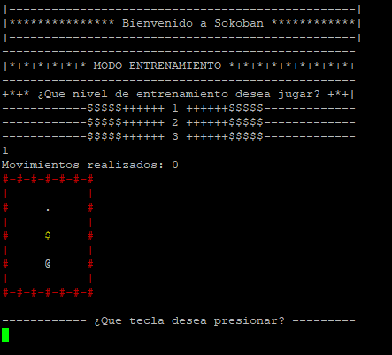
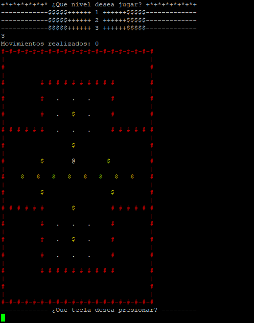
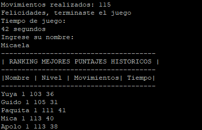

# Sokoban — ARM Assembly

---

## Descripción

Sokoban es un juego de lógica en el que el objetivo es desplazar todas las cajas hasta sus respectivos destinos, evitando quedar bloqueado durante el recorrido.

Este proyecto fue desarrollado como parte de la Tecnicatura Universitaria en Informática, con el propósito de aplicar conocimientos de arquitectura de computadoras y programación en lenguaje ensamblador.

## Funcionalidades

- Juego principal con diferentes niveles.
- Modo entrenamiento con mapas adicionales.
- Control del personaje y desplazamiento de cajas.
- Contador de movimientos realizados.
- Medición del tiempo de cada partida.
- Sistema de ranking con registro de resultados históricos.
- Reinicio de partidas.

## Controles

| Tecla | Acción                   |
| :---: | ------------------------ |
|  `W`  | Mover hacia arriba       |
|  `A`  | Mover hacia la izquierda |
|  `S`  | Mover hacia abajo        |
|  `D`  | Mover hacia la derecha   |
|  `R`  | Reiniciar partida        |

## Capturas de pantalla

### Menú principal

<p align="center">
  
</p>

### Juego principal

<p align="center">
  
</p>

### Ranking

<p align="center">
  
</p>

## Tecnologías utilizadas

- ARM Assembly
- GNU Assembler (GNU AS)
- Linux

## Estructura del proyecto

```text
Sokoban-ARM/
├── sokoban.asm
├── ranking.txt
├── capturas/
└── README.md
```

## Sobre el proyecto

Proyecto académico individual desarrollado en el marco de la Tecnicatura Universitaria en Informática.

